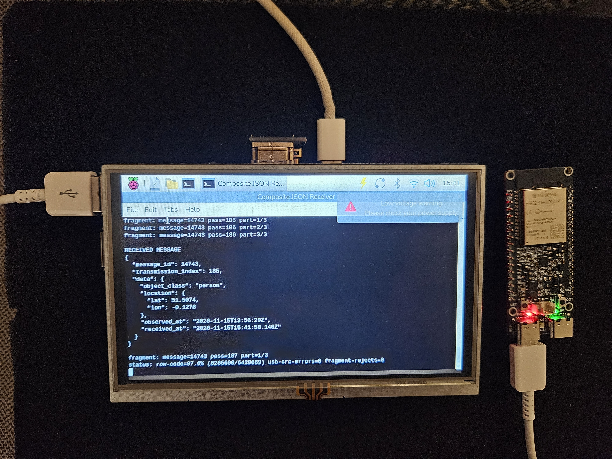
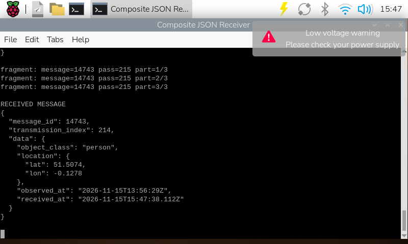

# Raspi VTX Data Link

<p align="center">
  
</p>

*Receiver Raspberry Pi displaying a recovered JSON message, with the ESP32-C5
connected over native USB.*


This project provides a low-rate, longer range data link for Rasberry Pi 4 that encodes JSON data within a composite video signal and transmits it over a 5.8GHz analogue FPV video transmitter. The data is recovered and demodulated by an ESP32-C5 running ESPsoup. ESPsoup firmware allows the ESP32-C5 to receive the signal, demodulate it into digital video lines, and forward those lines over native USB. A second Raspberry Pi reconstructs and validates the JSON data.


```text
TX Pi -> composite output -> analogue VTX -> 5.8 GHz
                                             |
RX Pi <- native USB <- ESP32-C5 + ESPsoup <--+
```

## Hardware

The transmitter follows the practical composite-video approach documented in
[mdwasserman/Raspi_Transmitter](https://github.com/mdwasserman/Raspi_Transmitter):
a Raspberry Pi drives an analogue 5.8 GHz VTX through its composite output.
This project replaces the visible desktop picture with a machine-readable
black-and-white data grid.


<p align="center">
  
</p>


*Example transmitter hardware from
[mdwasserman/Raspi_Transmitter](https://github.com/mdwasserman/Raspi_Transmitter)*


### Receiver output

<p align="center">
  
</p>

Successive messages received through the live analogue link. The status line
shows no USB CRC errors in this capture.

## Payload

The transmitted JSON has this shape:

```json
{
  "object_class": "person",
  "location": {
    "lat": 51.5074,
    "lon": -0.1278
  },
  "observed_at": "2026-11-15T13:56:29Z"
}
```

`location` is an object rather than an array. `observed_at` describes when the
source observation occurred. After a complete CRC-valid message is recovered,
the receiver adds its own `received_at` timestamp.

## Quick start

You need:

- A Raspberry Pi with composite output connected to an analogue FPV VTX. See [here](https://github.com/mdwasserman/Raspi_Transmitter)
- An ESP32-C5 with a suitable 2.4/5 GHz antenna and native USB connection.
- A receiving Raspberry Pi connected to the ESP32-C5 native USB port.
- ESPsoup firmware on the ESP32-C5.
- Python 3, Tkinter on the TX Pi, and pySerial on the RX Pi.

Install the small host-side dependencies on both Pis:

```sh
sudo apt update
sudo apt install -y python3-tk python3-serial
```


### 1. Flash ESPsoup once

Skip this step if the ESP32-C5 already runs ESPsoup. Connect its **native USB**
port, not its CH340 USB-to-UART port.

1. Open the [ESPsoup web app](https://app.espsoup.com/) in Chrome or Edge.
2. Select **Device → Firmware**.
3. Connect the ESP32-C5 and install the suggested ESPsoup firmware.

The app includes the required C5 firmware, backs up the board, flashes it, and
verifies the result. Building from source is only necessary for firmware
development; the commands are maintained in the
[ESPsoup firmware repository](https://github.com/pit711/espsoup-firmware).

### 2. Start the receiver

```sh
python3 rx_matrix.py --frequency 5865
```

Run this on the receiving Pi connected to the ESP32-C5. The default USB device
is `/dev/ttyACM0`; use `--port /dev/ttyACM1` if necessary.

### 3. Start the transmitter

```sh
python3 tx_matrix.py --object-class person --lat 51.5074 --lon -0.1278 --count 3
```

Run this from the transmitting Pi's graphical desktop. The receiver tunes
ESPsoup, validates the received rows, reconstructs the JSON, and prints complete
messages in its terminal.

When starting it over SSH, provide the desktop display:

```sh
DISPLAY=:0 XAUTHORITY="$HOME/.Xauthority" \
python3 tx_matrix.py \
  --object-class person \
  --lat 51.5074 \
  --lon -0.1278 \
  --count 3
```

`--count` counts complete messages, not fragments:

- `--count 1` sends the message once.
- `--count 5` sends five complete copies.
- `--count 0` repeats indefinitely.

A complete object may be supplied directly:

```sh
python3 tx_matrix.py \
  --payload-json '{"object_class":"vehicle","location":{"lat":51.5,"lon":-0.12},"observed_at":"2026-11-15T14:00:00Z"}' \
  --count 3
```

Or read it from a file:

```sh
python3 tx_matrix.py --payload-file message.json --count 1
```

Press Escape in the data window to stop the transmitter. A remote loop can be
stopped with `pkill -f tx_matrix.py`.

## How the data is encoded as video

- The screen contains 64 logical rows and 32 black/white cells per row.
- Each row carries one byte plus sync, frame sequence, row address, CRC-8, and
  an end marker.
- One transport fragment carries 51 JSON bytes across the 64 rows.
- Each fragment has a message ID, transmission index, fragment index/count,
  payload length, and CRC-32.
- Broad cells and repeated physical scanlines provide analogue-link
  redundancy. Invalid rows and fragments are discarded rather than guessed.

The initial hardware test transported a 103-byte JSON object in three
fragments, recovering all three requested message transmissions with zero USB
CRC errors. With the conservative default `--hold-ms 350`, useful throughput is
approximately 100 bytes/s in that setup. This is a bench result, not a range or
weak-signal claim.

## Project scope and attribution

The receiver uses the documented `VFM`/`VFL` protocol from
[ESPsoup firmware](https://github.com/pit711/espsoup-firmware) by the ESPsoup
contributors. ESPsoup is a receive-only GPL-3.0 project derived from
[ESPARGOS ESP-SDR](https://github.com/ESPARGOS/esp-sdr).

The analogue Raspberry Pi/VTX hardware arrangement is based on
[Raspi_Transmitter](https://github.com/mdwasserman/Raspi_Transmitter) by
mdwasserman. Its linked photograph remains credited to that Apache-2.0 project.

This work also builds on receiver methods and findings from
[C5VRX](https://github.com/Twotoz/C5VRX) by Twotoz and the C5VRX contributors.
Visit the [official C5VRX website](https://twotoz.github.io/C5VRX/) for the
original project and its Discord invite. 

